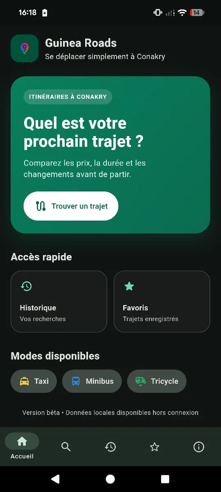
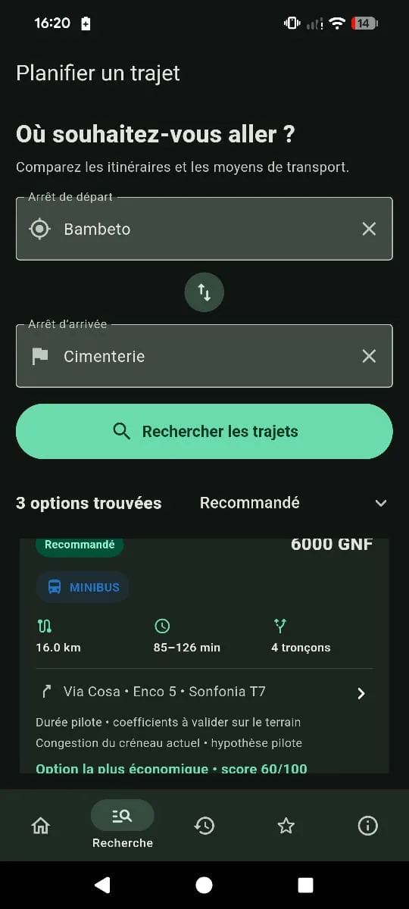
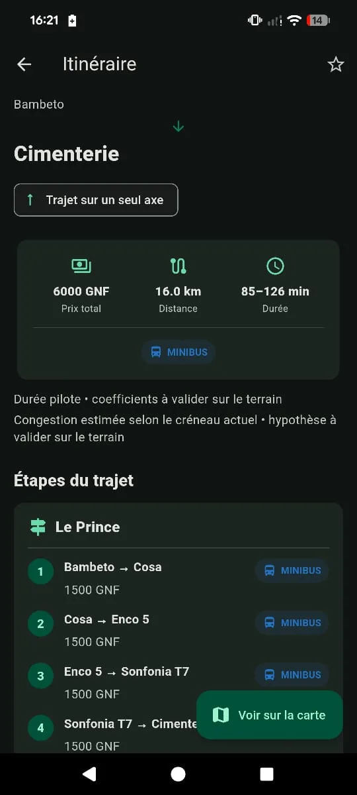
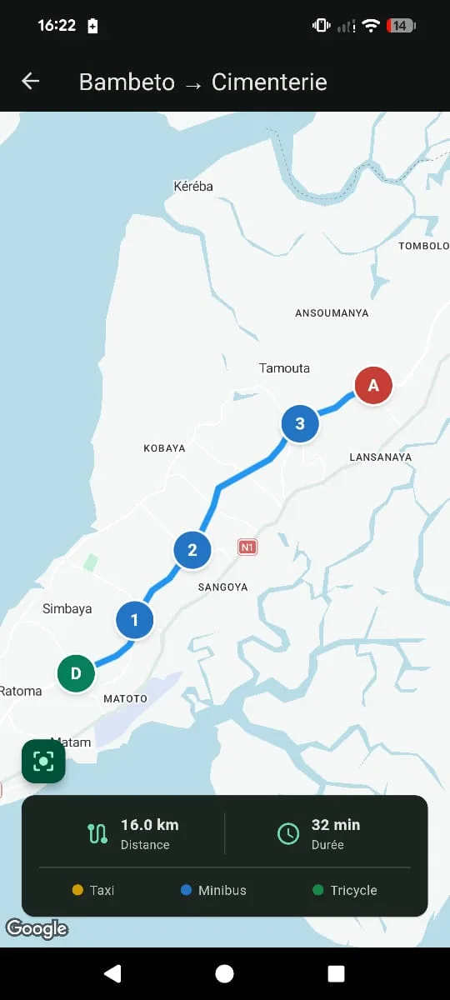

# Guinea Roads

Application mobile Flutter pour se déplacer en transport en commun à Conakry.
On choisit un arrêt de départ et un arrêt d'arrivée, et l'application compare
les trajets possibles en taxi, minibus et tricycle : prix, durée estimée selon
l'heure de départ, changements à faire, puis tracé sur Google Maps.

<p align="center">
  
  
  
  
</p>

## Fonctionnalités

- Recherche des arrêts par quartier ou par repère.
- Comparaison des options, triées par prix, durée ou nombre de changements,
  avec une option recommandée et la raison du choix.
- Plus court chemin pondéré (Dijkstra) sur un graphe d'axes et de
  correspondances.
- Prix par tronçon et par mode de transport.
- Durée corrigée selon les créneaux de congestion (heures de pointe).
- Correspondances à pied avec durée et consignes.
- Tracé routier via Google Routes API, mis en cache 30 minutes.
- Historique des recherches et trajets favoris, enregistrés sur le téléphone.
- Données disponibles hors connexion (Firestore hors ligne et fichier JSON de
  secours).

Les tarifs, durées et créneaux de congestion indiquent s'ils ont été vérifiés
sur le terrain ou s'ils restent des hypothèses pilotes.

## Stack

Flutter, Dart, Cloud Firestore, Google Maps SDK et Google Routes API.

## Tests

```bash
flutter test
```

## Google Maps et itinéraires

La carte Android et le service web Routes utilisent deux types
d'autorisation différents. La clé déclarée dans
`android/local.properties` sert uniquement au SDK Maps Android :

```properties
MAPS_API_KEY=VOTRE_CLE_MAPS_ANDROID
```

Cette clé doit être restreinte à l'application Android
`com.example.guinea_roads`, à ses empreintes SHA et uniquement à
**Maps SDK for Android**. Le manifeste reçoit automatiquement cette valeur au
moment de la compilation.

Pour afficher le tracé routier, activez **Routes API** et la
facturation dans le même projet Google Cloud, puis lancez l'application avec
une clé dédiée au service web :

```bash
flutter run --dart-define=GOOGLE_ROUTES_API_KEY=VOTRE_CLE_ROUTES
```

En développement, copiez `config/routes.dev.example.json` vers
`config/routes.dev.json`, renseignez-y la clé régénérée, puis utilisez la
configuration **Guinea Roads (dev)** dans Android Studio ou VS Code. En ligne
de commande, l'équivalent est :

```bash
flutter run --dart-define-from-file=config/routes.dev.json
```

`config/routes.dev.json` est ignoré par Git et ne doit jamais être partagé.

Une clé Routes ne devrait pas être publiée dans une application de
production. Faites passer ces requêtes par un backend/proxy avant diffusion.
Sans clé valide, l'application affiche volontairement une ligne pointillée
approximative entre les arrêts et indique la cause du refus Google.

`android/app/google-services.json` configure Firebase. Il ne contient ni la
clé Maps Android utilisée par le manifeste ni la clé Routes. Ne le remplacez
que si l'application Android est déplacée vers un autre projet Firebase.
